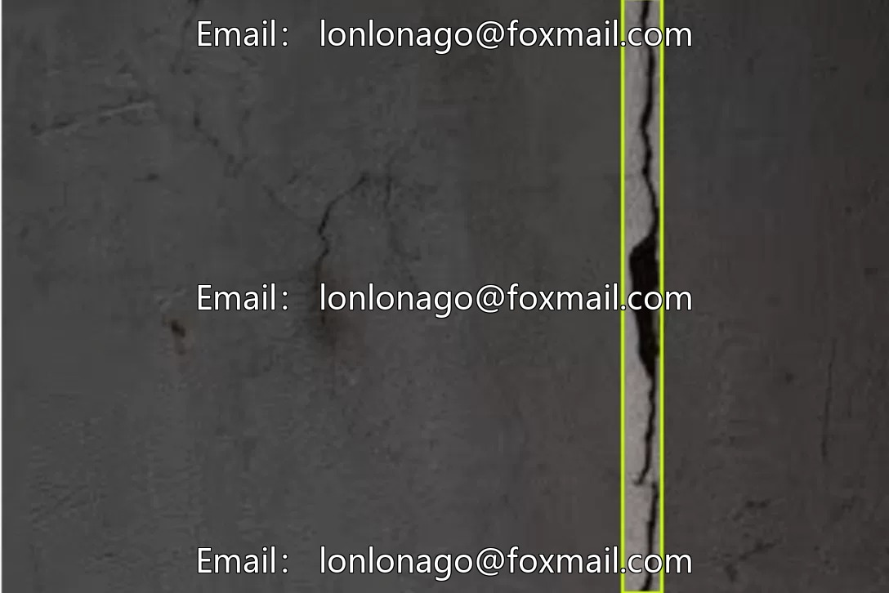
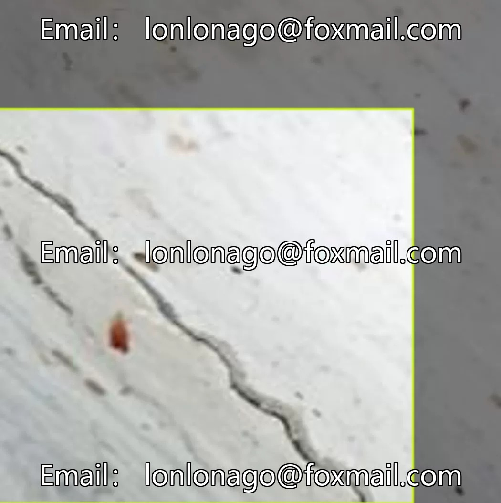
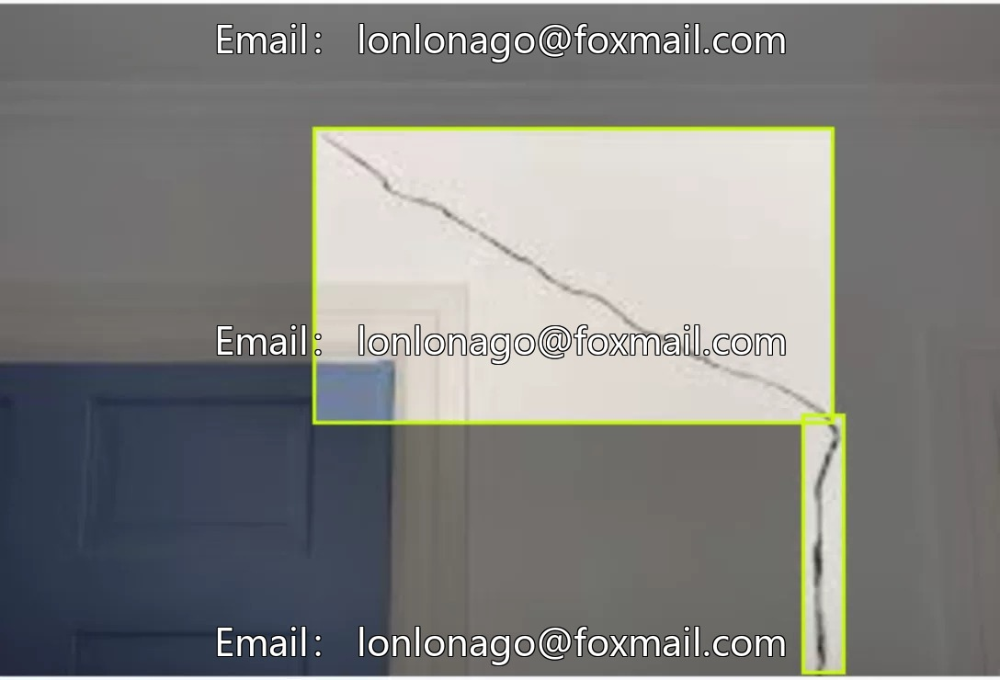
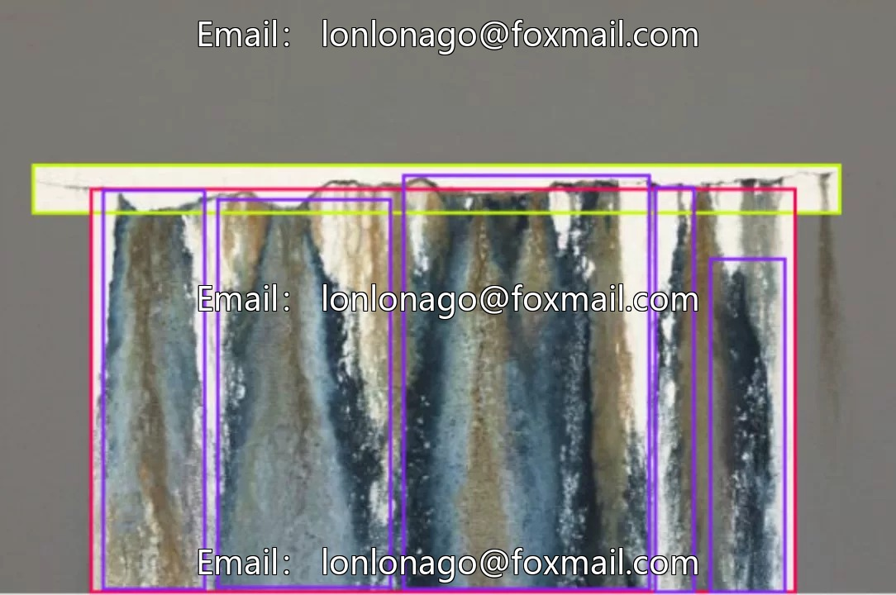

# Targets inside the building, such as wall mold, cracks on the exterior walls, safety cracks, peeling of the wall surface, and water seepage on the wall.

## Body

Building wall mould, cracks on the exterior wall, safety cracks, peeling paint, water seepage target detection dataset, 10211th issue, 2949 images, 5 categories: crack (crack), mold (mold), peeling_paint (peeling paint), stairstep_crack (stairstep crack), water_seepage (water seepage), suitable for computer vision object detection tasks.

The data format is an image file, supporting common annotation formats such as XML and TXT, which can be directly used for model training and testing. The dataset is large in scale, providing sufficient samples for model development.

Virtual materials, once sold, are non-refundable.
Interested friends, click "I want" to proceed.

## Images

## Payment

Here is a pay link on Stripe ( https://buy.stripe.com/3cs8yP7sY87d0vu9AB ). Please contact me lonlonago@foxmail.com after funding $89, and I will send you a complete data files , thank you!

